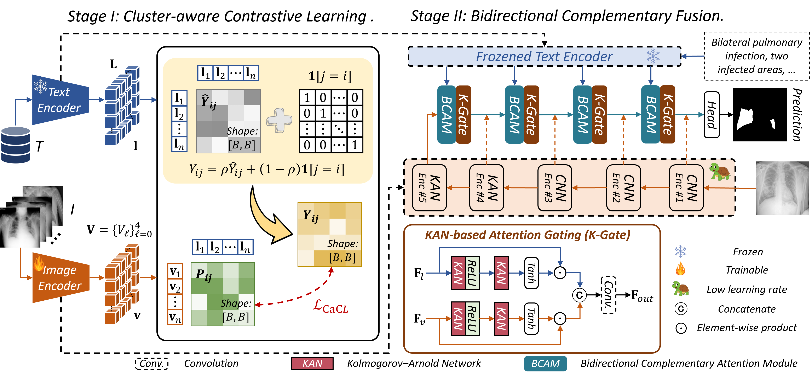
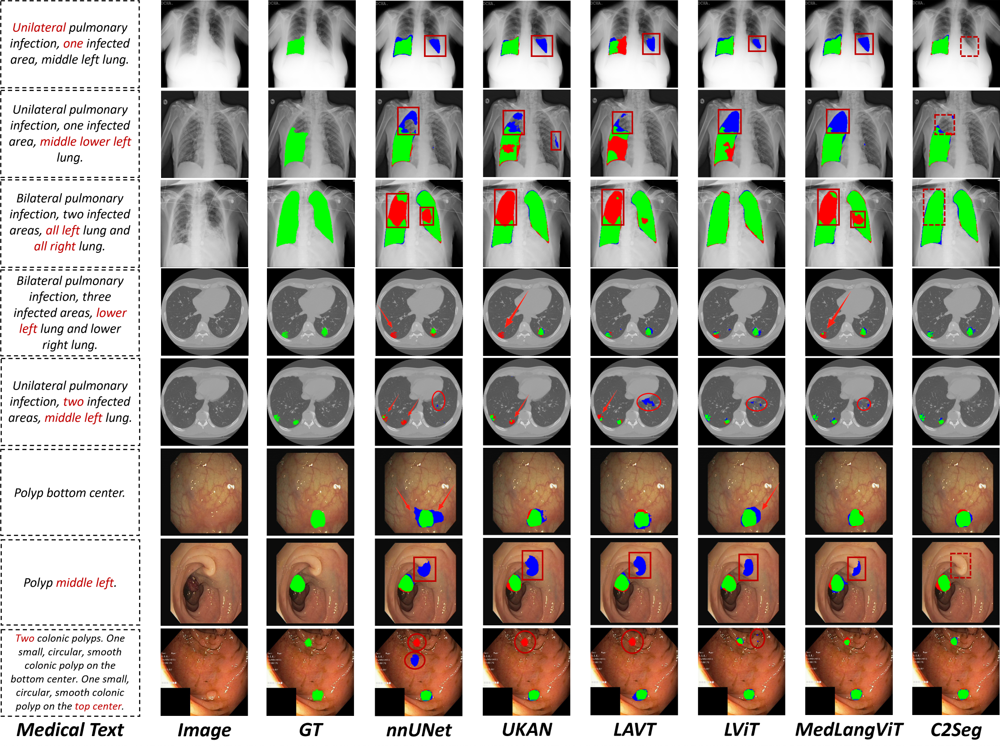

<div align="center">

# Towards Text-Mask Consistency in Medical Image Segmentation

**Jie Gui · Hang Tu · Wen Sha · Xiuquan Du**

*🎉 International Conference on Learning Representations (ICLR 2026)*

[](https://proceedings.iclr.cc/paper_files/paper/2026/hash/5a8a65248b58794b53ab0f1b4587860d-Abstract-Conference.html)
[](https://arxiv.org/abs/XXXX)
[](https://openreview.net/forum?id=riOevy2RwZ)
[](https://pytorch.org/)

Official PyTorch implementation of **C2Seg (Consistency-enhanced Two-stage Segmentation)** for text-guided medical image segmentation.

</div>

---

## 🔎 Overview

Medical image segmentation guided by natural-language descriptions requires predictions to align not only with image appearance but also with **textual attributes**, including lesion quantity and spatial location. C2Seg addresses this task through a two-stage vision–language framework that promotes semantic alignment and spatially informed feature fusion.

The framework combines three key components:

- **Cluster-aware Contrastive Learning (CaCL):** encourages robust cross-modal alignment by using semantic relationships between text descriptions to reduce contrastive conflicts.
- **Bidirectional Complementary Attention Module (BCAM):** integrates vision-dominant and language-dominant representations while preserving spatial information.
- **KAN-based Attention Gating (K-Gate):** selectively refines and fuses multimodal features for precise segmentation.

The implementation uses a hybrid visual encoder, a frozen **CLIP ViT-B/32** text encoder, and a multi-scale segmentation decoder.

## 🧠 Method

<div align="center">
  
  <p><em>Overview of C2Seg.</em></p>
</div>

**Stage I — Cross-modal pretraining.** CaCL learns semantically aligned visual representations using text-derived soft supervision. The visual encoder is pretrained while the CLIP text encoder stays frozen. The selected Stage I checkpoint initializes the visual encoder for segmentation.

**Stage II — Text-guided segmentation.** BCAM establishes complementary visual and language feature pathways, followed by K-Gate fusion and a multi-scale decoder. The segmentation model is trained with deep supervision and automatically evaluated using its best validation-Dice checkpoint.

## 📊 Results

| Dataset | Dice (%) ↑ | mIoU (%) ↑ | HD95 ↓ | ASSD ↓ |
|:--|--:|--:|--:|--:|
| **QaTa-COV19** | **85.25** | **76.97** | **12.71** | **3.38** |
| **MosMedData+** | **77.81** | **65.17** | **15.02** | **3.76** |
| **CVC-ClinicDB** | **91.82** | **86.81** | **6.53** | **2.23** |
| **Kvasir** | **91.92** | **85.27** | **13.62** | **3.98** |

Dice and mIoU measure region overlap; HD95 and ASSD assess segmentation boundary quality. **↑** denotes higher is better, and **↓** denotes lower is better.

### 🖼️ Qualitative Visualization

<div align="center">
  
  <p><em>Qualitative comparisons. Green: true positive; red: false negative; blue: false positive.</em></p>
</div>

## 🗂️ Datasets

C2Seg supports four image–mask–text segmentation datasets:

| Dataset name in `args.py` | Image modality | Segmentation target | Text annotations |
|:--|:--|:--|:--|
| `QaTa-COV19` | Chest X-ray | Pulmonary infection | [LViT](https://doi.org/10.1109/TMI.2023.3291719) |
| `MosMedData+` | Chest CT | Pulmonary infection | [LViT](https://doi.org/10.1109/TMI.2023.3291719) |
| `CVC-ClinicDB` | Colonoscopy | Colorectal polyp | [MedVLSM](https://proceedings.mlr.press/v250/poudel24a.html) (P6) |
| `Kvasir-SEG` | Colonoscopy | Colorectal polyp | [MedVLSM](https://proceedings.mlr.press/v250/poudel24a.html) (P6) |

Arrange each dataset under the configured data root using the following structure:

```text
data/
└── <DATASET>/
    ├── Train_Folder/
    │   ├── images/
    │   ├── masks/
    │   └── Train_text.xlsx
    ├── Val_Folder/
    │   ├── images/
    │   ├── masks/
    │   └── Val_text.xlsx
    └── Test_Folder/
        ├── images/
        ├── masks/
        └── Test_text.xlsx
```

Each Excel file contains two columns:

| Column | Description |
|:--|:--|
| `Image` | Image filename (or the corresponding paired mask identifier) |
| `Description` | Natural-language description of the target region |

Image filenames, masks, and text descriptions are matched by the dataset loader. Keep the dataset splits and associated descriptions unchanged.

## 🛠️ Installation

**Requirements:** Python 3.10+, PyTorch with CUDA support, and the packages listed in `requirements.txt`.

Clone or download this repository, then install the dependencies from the project root:

```bash
cd C2Seg
pip install -r requirements.txt
```

Download the **OpenAI CLIP ViT-B/32** checkpoint and place it at:

```text
pretrained/ViT-B-32.pt
```

## ⚙️ Configuration

Choose the dataset at the top of `args.py`:

```python
DATASET = "MosMedData+"  # QaTa-COV19 | MosMedData+ | CVC-ClinicDB | Kvasir-SEG
```

To use a different filesystem location or GPU without editing the source:

```bash
export C2SEG_DATA_ROOT="/path/to/datasets"
export C2SEG_CLIP_WEIGHTS="/path/to/ViT-B-32.pt"
export C2SEG_DEVICE="cuda:0"
```

## 🚀 Training & Evaluation

After selecting the dataset in `args.py`, run:

```bash
python train_model.py
```

This command automatically performs:

1. **Stage I:** CaCL pretraining and checkpoint selection.
2. **Stage II:** segmentation training initialized from the selected visual encoder.
3. **Model selection:** checkpointing based on validation Dice.
4. **Evaluation:** test-set inference using the selected checkpoint.
5. **Saving:** configuration files, training logs, evaluation metrics, per-image results, and model weights.

A matching Stage I checkpoint can be reused through the saved plain-text training configuration.

### Evaluate a Saved Checkpoint

For a standalone test evaluation of a completed run:

```bash
python test_model.py --config "results/Kvasir-SEG/<RUN_ID>/stage2/config.json"
```

You can also specify the checkpoint explicitly:

```bash
python test_model.py \
  --config "results/Kvasir-SEG/<RUN_ID>/stage2/config.json" \
  --checkpoint "weights/Kvasir-SEG/<RUN_ID>/stage2/best.pth"
```

## 📁 Output Structure

Every training run creates a timestamped directory under `results/` and `weights/`:

```text
results/<DATASET>/<RUN_ID>/
├── stage1/
│   ├── config.json
│   ├── train.log
│   └── metrics.json
├── stage2/
│   ├── config.json
│   ├── train.log
│   ├── metrics.json
│   └── sample_metrics.csv
└── status.json

weights/<DATASET>/<RUN_ID>/
├── stage1/
│   └── selected.pth
└── stage2/
    └── best.pth
```

The evaluation reports **Dice, mIoU, accuracy, sensitivity, specificity, HD95, and ASSD**, together with the selected epoch and training information. HD95 and ASSD are expressed in pixels for the resized evaluation masks.

## 📝 Citation

If you find C2Seg useful in your research, please cite our ICLR 2026 paper:

```bibtex
@inproceedings{gui2026c2seg,
  title     = {Towards Text-Mask Consistency in Medical Image Segmentation},
  author    = {Gui, Jie and Tu, Hang and Sha, Wen and Du, Xiuquan},
  booktitle = {International Conference on Learning Representations},
  year      = {2026}
}
```

## 🤝 Acknowledgments

C2Seg builds on open research in vision–language modeling and medical image segmentation. We acknowledge [OpenAI CLIP](https://github.com/openai/CLIP), [LViT](https://doi.org/10.1109/TMI.2023.3291719), and [MedVLSM](https://github.com/naamiinepal/medvlsm) for their foundational models, datasets, and annotations.

---

<div align="center">
  <sub>C2Seg · Towards Text-Mask Consistency in Medical Image Segmentation · ICLR 2026</sub>
</div>
